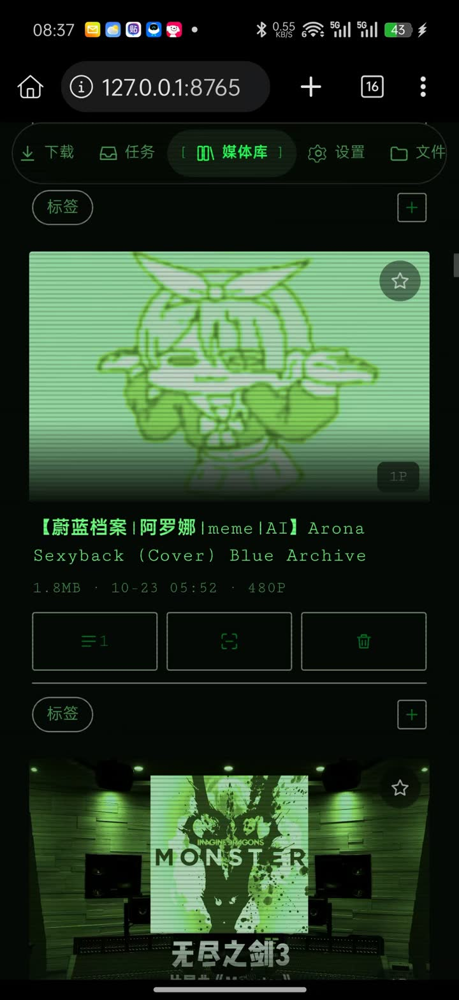
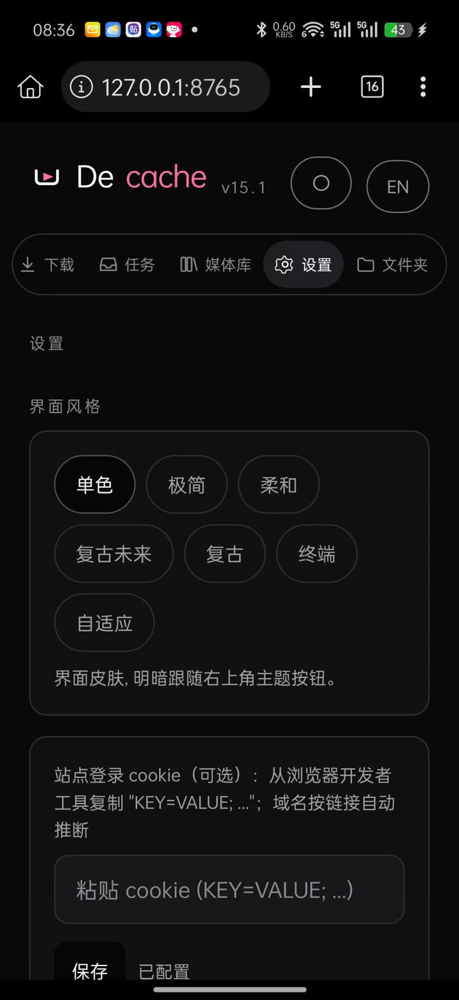
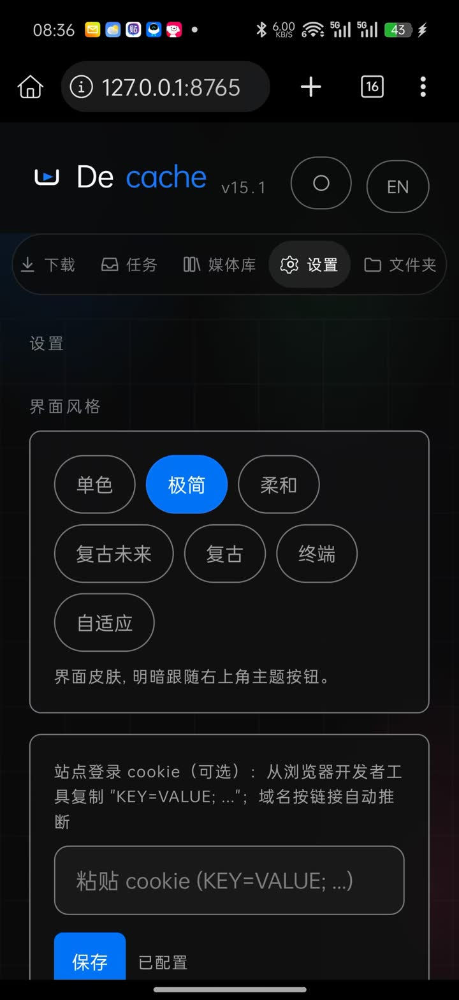
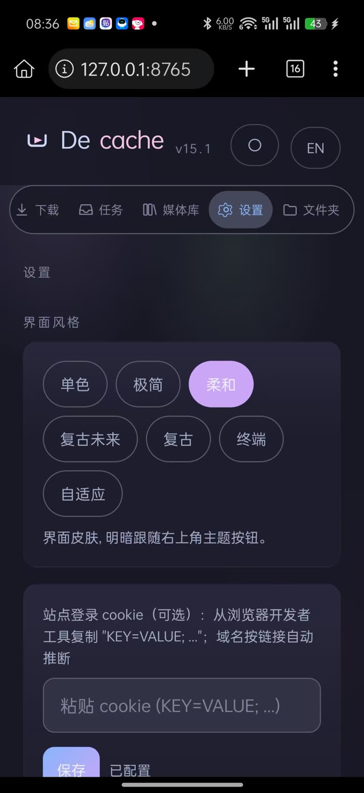
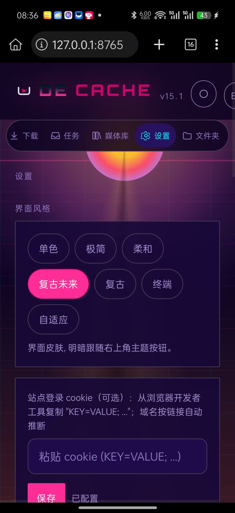
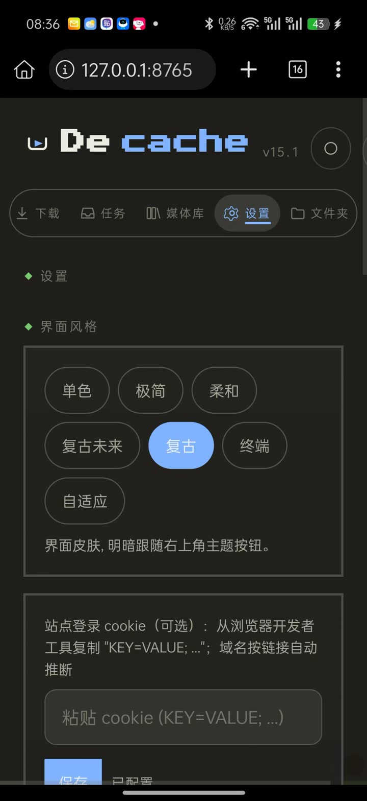
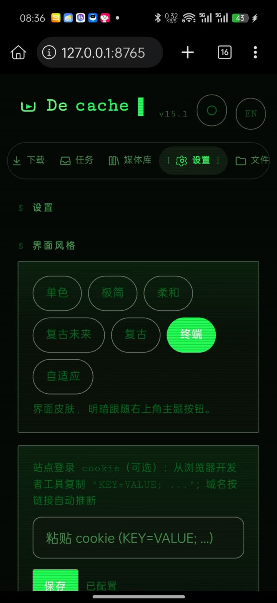

# Decache

**自托管的本地媒体库与视频播放器 · Self-hosted local media library & video player**

把"缓存里的东西"变成"你自己的文件"。
Turn "stuff in your cache" into "files you own".

`v16.2` · 纯标准库 Python 后端 · 零构建单文件前端 · 安卓 / Windows / macOS / Linux 全平台

---

## 这是什么 / What it is

**中文** — Decache 是一个装在你自己设备上的小网站：粘贴链接，视频存进你自己的硬盘；浏览器里播放，带播放列表、字幕、续播。文件全在本地——不上传、不收钱、不看广告、不收集数据。界面中英切换（右上角 `EN`）。

**English** — Decache is a small web app that lives on your own device: paste a link and the file lands on your disk; play it back in a browser with playlists, subtitles and resume. Everything stays local — no uploads, no accounts, no ads, no telemetry. Chinese/English UI toggle (`EN`, top right).

## 能干什么 / What it can do

| 功能 / Feature | 说明 / Details |
| --- | --- |
| 下载 / Download | 主流视频站（含 B 站），清晰度自选，支持多链接批量粘贴 / Most video sites (incl. Bilibili), quality picker, batch paste multiple links |
| 本地播放器 / Player | 进度条实时画面预览、A-B 循环、播放列表、画中画、倍速、字幕、手势（进度/音量/亮度）/ Live seek preview, A-B loop, playlist, PiP, speed, subtitles, gestures (seek/volume/brightness) |
| 着色器特效 / Shader FX | CRT 电视 / VHS 录像 / 胶片颗粒 / 霓虹辉光四档 GPU 后处理，播放器内一键切换 / CRT, VHS, film grain, neon glow — 4 GPU post-processing presets, switchable in-player |
| 七套主题 / 7 Themes | 默认 / Geist / 奶油玻璃 / 复古未来 / 像素庄园 / 终端 / **自适应**（取视频主色实时生成色板）/ Mono, Geist, Catppuccin, Synthwave, Retro, Terminal, **Adaptive** (samples the video's dominant colour live) |
| 媒体库 / Library | 封面墙、彩色标签、收藏、**续播**（看到哪记到哪，重装不丢）、多选删除、查重、统计仪表盘 / Cover wall, colour tags, favourites, **resume** (position synced to server, survives reinstall), bulk delete, dedupe, stats dashboard |
| 观看体验 / Watching | 睡眠定时、最近播放、下载历史、亮度上限 100% 五档步进、中央大播放键 / Sleep timer, recent list, download history, brightness capped at 100% in 5% steps, big centre play button |
| 全平台格式 / Plays anywhere | 统一 H.264 + AAC，手机 / 平板 / 电视 / 浏览器全认 / H.264 + AAC, every device understands it |

## 截图 / Screenshots

真机截图（安卓手机，Termux），未做任何修饰。
Real screenshots from an Android phone (Termux), unmodified.

<table>
<tr>
<td align="center" width="50%"><br><sub>媒体库 · 终端主题 · 标签 / 收藏 / 分辨率角标 / Library</sub></td>
<td align="center" width="50%"><br><sub>媒体库 · 条目操作 / 封面扫描线 / Library</sub></td>
</tr>
</table>

**七套主题，一键切换 / 7 themes, one tap**

<table>
<tr>
<td align="center" width="25%"><br><sub>单色 (默认) / Mono</sub></td>
<td align="center" width="25%"><br><sub>极简 / Geist</sub></td>
<td align="center" width="25%"><br><sub>柔和 / Catppuccin</sub></td>
</tr>
<tr>
<td align="center" width="25%"><br><sub>复古未来 / Synthwave</sub></td>
<td align="center" width="25%"><br><sub>复古 / Retro</sub></td>
<td align="center" width="25%"><br><sub>终端 / Pipboy</sub></td>
</tr>
</table>

## 怎么安装 / Installation

### 安卓手机（Termux）/ Android (Termux)

**1** 装 [Termux](https://f-droid.org/packages/com.termux/)（**别用 Play 商店版**，太老跑不动）
/ Install [Termux](https://f-droid.org/packages/com.termux/) (**skip the Play Store build** — too old to run this)

**2** 授权存储（只做一次，**不做的话视频会存进你找不到的私有目录**）
/ Grant storage (once — without it downloads land in a private folder you can't reach):

```
termux-setup-storage
```

**3** 一行装好（依赖、引擎、面板文件全包）
/ One line does it (dependencies, engines, panel files):

```
curl -L -o install.sh https://raw.githubusercontent.com/mike22890/Decache/main/install.sh && bash install.sh
```

**4** 启动（**别关这个窗口**，前台保活，关了服务就停）
/ Start (**keep the window open** — it holds the service in the foreground):

```
bash ~/decache/start.sh
```

**5** 浏览器打开 → `http://127.0.0.1:8765`

> 不想用命令行？Releases 页下 `take-bundle.tar.gz`，解压后进文件夹跑 `bash install.sh`。
> No terminal? Grab `take-bundle.tar.gz` from the Releases page, unzip, run `bash install.sh` inside.

### Windows / Mac / Linux

**1** 装 Python 3.9+（Windows 勾 "Add Python to PATH"）和 ffmpeg / Install Python 3.9+ (tick "Add to PATH") and ffmpeg

**2** 下 [take-bundle.tar.gz](https://github.com/mike22890/Decache/releases/latest) 解压到任意文件夹 / Download the bundle, unzip anywhere

**3** 启动 / Start: Windows 双击 `start.bat`；Mac/Linux 终端跑 `bash start.sh` / double-click `start.bat`, or `bash start.sh`

**4** 浏览器打开 / Open → `http://127.0.0.1:8765`

### 手机访问电脑上的视频库 / Phone → computer library

`config.ini` 里 `bind = 127.0.0.1` 改成 `bind = 0.0.0.0`，重启。同 WiFi 下手机开 `http://电脑IP:8765`。
Edit `bind` to `0.0.0.0` in `config.ini`, restart, open `http://<pc-ip>:8765` on the same WiFi.

## 怎么用 / How to use

**下载**：下载页粘贴链接（支持一次粘贴多行批量）→ 解析 → 勾选分P选清晰度 → 下载所选 → 任务页看进度。
**Download**: paste a link (multiple lines = batch) → Parse → tick parts, pick quality → Download → watch on Tasks.

**播放**：媒体库点封面 → 点画面唤出控制条（3 秒无操作自动隐去）。顶栏：播放列表 / 队列 / 睡眠定时 / 特效切换；控制条：快退播放快进、A-B、倍速、循环、全屏。
**Play**: tap a cover in Library → tap the picture for controls (auto-hide in 3s). Top bar: playlist / queue / sleep timer / FX switcher; dock: prev/play/next, A-B, speed, loop, fullscreen.

**手势 / Gestures**：横向拖动 = 进度；右半屏纵向 = 音量；左半屏纵向 = 亮度（40%–100%，5% 步进，吸附 100% 显示"原色"）。
Horizontal drag = seek; right half vertical = volume; left half vertical = brightness (40–100%, 5% steps, snaps to 100%).

**设置**：右上角齿轮 — 主题七选一（自适应主题会跟着视频色调实时换色）、特效档位、凭据、睡眠定时、最近播放、统计、界面语言。
**Settings** (gear icon): 7 themes (Adaptive re-colours live from the video), FX presets, credentials, sleep timer, recent plays, stats, UI language.

## 常见问题 / FAQ

**下载失败？/ Download failed?** 任务页点"补下"；日志页看中文原因。 / Hit 补下 on the Tasks tab; the Log tab shows the reason.

**手机文件管理器找不到视频？/ Can't find files?** Termux 下在 `~/storage/downloads/decache`。 / Under Termux: `~/storage/downloads/decache`.

**iOS Safari 播不了？/ iOS won't play?** iOS 只认 MP4+H.264+AAC；选"自动(最优)"即可，HEVC/MKV 在播放器里点"生成通用版"转一下。 / iOS only plays MP4+H.264+AAC; pick 自动(最优), or convert HEVC/MKV via 生成通用版.

**特效黑屏/卡顿？/ FX black screen or janky?** 播放器里点 FX 切到"关"即回原生画面；渲染管线带黑屏自愈（异常自动回退）。 / Switch FX to 关 for plain video; the pipeline self-heals and falls back on render errors.

## 合法声明 / Legal

仅供个人学习研究与个人使用。请自行遵守所访问站点的服务条款与所在辖区著作权法律。本项目不提供任何站点专属解析器，不协助获取付费或受保护内容。
For personal study and use only. You are responsible for complying with the ToS of sites you access and your local copyright law. No site-specific parser ships with this project; it does not assist with paid or protected content.

## License

MIT — see LICENSE.

## 文档 / Documentation

- `HANDOVER.md` — 架构、设计决策、兼容性矩阵、45 节血泪教训（改代码前先读）/ architecture, design decisions, and 45 sections of blood-stained lessons (read before editing)
- `CHANGELOG.md` — 版本演进 / version history
- `LEGAL.md` — 法律声明 / legal notice
- `THIRD_PARTY_LICENSES.md` — 外部依赖归属 / third-party attribution
