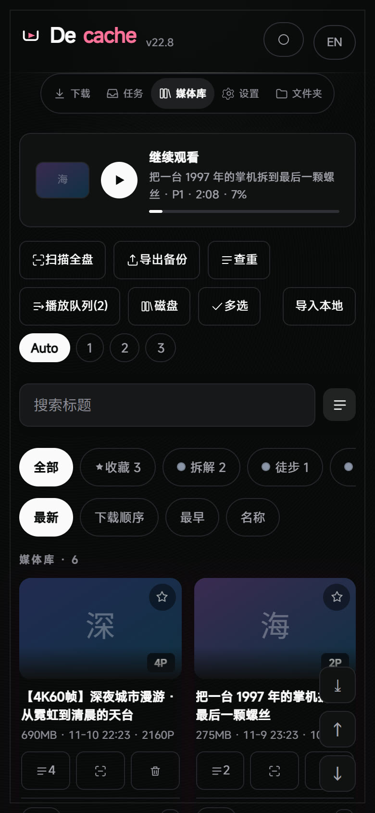
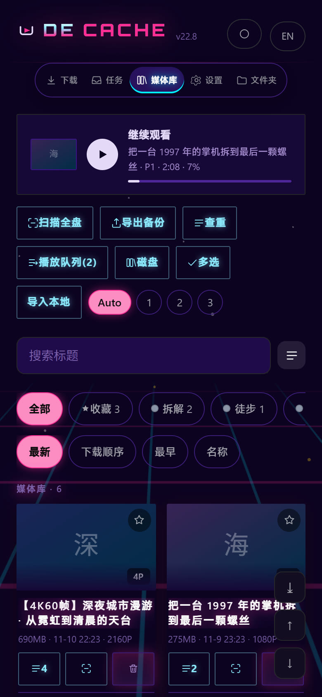
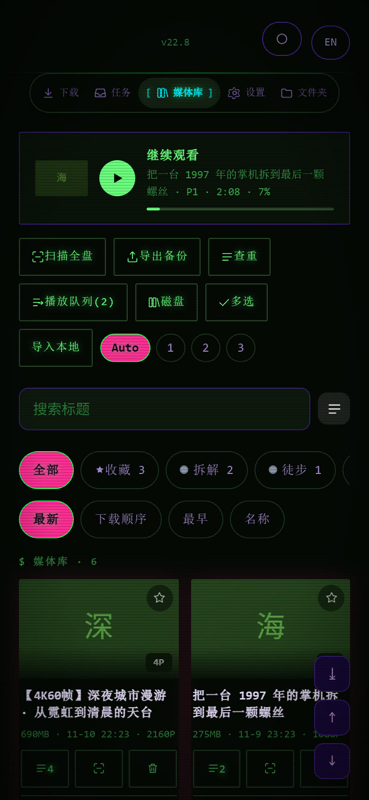
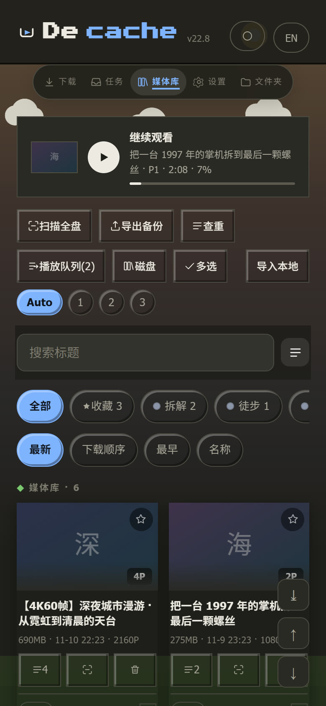
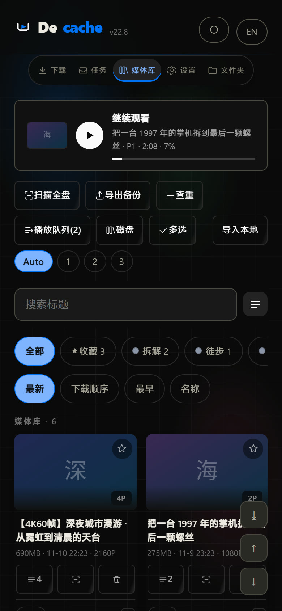
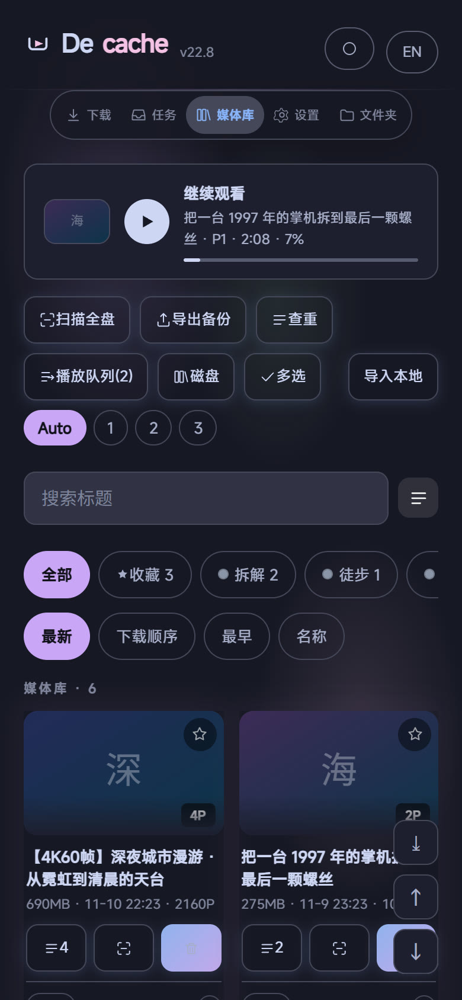
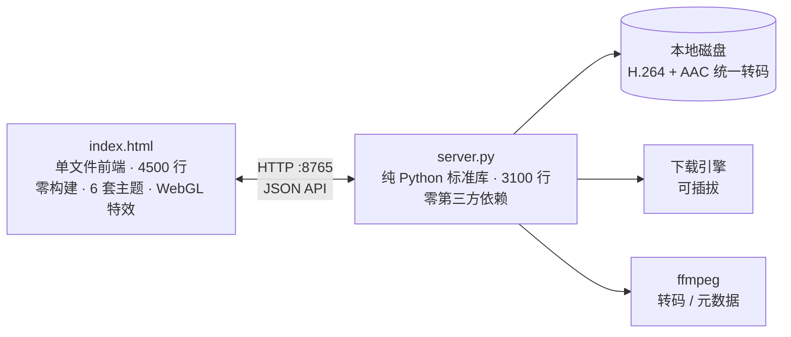

<div align="left">

# Decache

**一个自托管媒体库：纯 Python 标准库后端（零第三方依赖）+ 零构建单文件前端。装在 Android Termux 或桌面上，设备本机就是一台私人影音站。**

A self-hosted media library with a zero-dependency Python backend and a single-file, zero-build frontend. Runs on Android (Termux) or desktop — your device is the server.

    

[**官网 / Landing page**](https://mike22890.github.io/Decache/) · [**下载**](https://github.com/mike22890/Decache/releases/latest) · [llms.txt](https://mike22890.github.io/Decache/llms.txt)（给 AI 的机器可读索引）

</div>

> **不用 Docker，不用数据库，不用 npm。** 后端 3100 行只 import 标准库；前端是一个 HTML 文件。装完就是 9 个文件 + 一个 Python 进程。

## 硬数字

| 项 | 值 |
|---|---|
| 第三方依赖 | **0**（外部可执行文件只有 ffmpeg 和下载引擎） |
| 前端文件数 | **1**（`index.html`，约 4500 行，零构建） |
| 后端行数 | **约 3100**（`server.py`，只用 Python 标准库） |
| 安装产物 | **1 个自包含 `install.sh`**，内嵌 9 个文件 |
| 界面主题 | **6 套**，一键切换 |
| 前端静态闸 | **8 道**（语法 / id 悬空 / 未声明标识符 / 模板串泄漏 / 图标引用 / 同名函数 / 变量遮蔽 / CSS 属性级） |
| 默认监听 | `127.0.0.1:8765`（只绑回环） |
| 许可 | MIT |

## 真机截图

<table>
<tr>
<td align="center" width="33%"><br><sub>单色 · 媒体库</sub></td>
<td align="center" width="33%"><br><sub>复古未来 · 媒体库</sub></td>
<td align="center" width="33%"><br><sub>终端 · 媒体库</sub></td>
</tr>
<tr>
<td align="center" width="33%"><br><sub>复古</sub></td>
<td align="center" width="33%"><br><sub>极简</sub></td>
<td align="center" width="33%"><br><sub>柔和</sub></td>
</tr>
</table>

## 它是什么 / 不是什么

**是**：一个能自己启动的本地服务（浏览器打开就是完整媒体库）+ 一个下载队列（贴链接 → 分 P 下载 → 自动转 H.264/AAC 的 MP4）+ 一个手势播放器 + 一份放在你自己盘上的普通文件。

**不是**：不是云服务（无账号、无同步、无遥测）；不是媒体服务器集群（单进程、面向单机）；**不做站点适配**——源码刻意不内置任何具体站点的解析逻辑，站点支持完全取决于所装引擎（CI 有闸门盯着这条）。

## 和同类项目差在哪

| | **Decache** | Jellyfin | Metube | cobalt |
|---|---|---|---|---|
| 形态 | 零依赖 Python + 单 HTML | .NET 服务端 | yt-dlp 的 Web 外壳 | 取流服务 |
| 部署 | **手机本机 / 桌面，不用 Docker** | NAS、服务器 | 容器 | 容器 / 云 |
| 下载 + 入库转码 | **内置** | 不做 | 只下载 | 只取流 |
| 播放器 | **自带（手势/字幕/特效）** | 自带 | 无 | 无 |
| 库管理 | **内置（标签/收藏/续播/查重）** | 自带 | 无 | 无 |
| 许可 | MIT | GPL-2.0 | AGPL-3.0 | AGPL-3.0 |

<sub>竞品定位取自各自仓库说明（2026-11 核对）。三者的共同点是**都不覆盖「链接 → 下载 → 转码 → 播放 → 库管理」这条完整链路**，也不以「设备本机当服务器」为目标。</sub>

## 30 秒装好

**安卓（Termux）**——装 [Termux](https://f-droid.org/packages/com.termux/)（别用 Play 商店版），然后：

```bash
termux-setup-storage
curl -L -o install.sh https://raw.githubusercontent.com/mike22890/Decache/main/install.sh && bash install.sh
bash ~/decache/start.sh        # 浏览器打开 http://127.0.0.1:8765
```

**Windows / macOS / Linux**——需要 Python **3.11+**（面板本体 3.9 也能跑，但下载引擎 [yt-dlp](https://pypi.org/project/yt-dlp/) 自 2026.10.26 起要求 ≥3.11）和 ffmpeg。从 [Releases](https://github.com/mike22890/Decache/releases/latest) 下 `take-bundle.tar.gz` 解压，Windows 双击 `start.bat`，其余 `bash start.sh`。

**想让别的设备看这台机器的库**：`config.ini` 里 `bind = 0.0.0.0` 重启（**注意：这会把库暴露到局域网**），同 WiFi 下开 `http://这台机器IP:8765`。

## 常见问题

**要 Docker 吗？** 不用。后端只依赖 Python 标准库，前端是一个 HTML 文件；安装就是解压几个文件并起一个 Python 进程。

**能装在手机上吗？** 能，这是主要用法。Android 装在 Termux 里，服务跑在本机 `127.0.0.1:8765`，不需要 root。

**和 Jellyfin 有什么区别？** Jellyfin 管「已经有的片子」；Decache 管「从链接到能播」。Jellyfin 不做下载与入库转码、需要 .NET 服务端；Decache 内置队列和转码，后端是纯标准库。

**要多少内存？** 常驻在几十 MB 量级（单进程标准库 HTTP 服务）；转码时取决于 ffmpeg 与分辨率。

**会收集数据吗？** 不会。没有账号体系、没有遥测、没有云端。库文件与媒体都在本地磁盘，服务默认只绑回环地址。

**支持哪些站点？** 取决于你装的下载引擎（yt-dlp / ytta / you-get）。本项目刻意不内置站点解析代码——站点改版由引擎升级解决。

**下载失败怎么办？** 任务页点「补下」，日志里有中文原因。若是「下回来的是网页」这类，通常是链接形态问题，不是凭据问题。

**iOS 播不了某个文件？** iOS 只认 MP4(H.264+AAC)。选「自动(最优)」，或对已有文件点「生成通用版」。

**文件管理器找不到视频？** Termux 下在 `~/storage/downloads/decache`，或安装目录下的下载目录。

**特效黑屏？** 渲染管线带黑屏自愈会自动回退；也可在 FX 里切「关」回原生画面。

## 架构



下载引擎与站点解析完全可插拔，源码不内嵌任何站点专属逻辑（CI 里有闸门盯着）。

## 质量纪律

不靠「我测过了」，靠闸门：

- **`frontcheck.mjs`** —— 前端 **8 道**静态闸（语法 / 结构 / 语义逐层扫，最后一道是 CSS 属性级校验）
- **`selftest.py`** —— 端点级自检，隔离临时 HOME、无网络跑全流程
- **`chaos_test.py` / `fake_yt_dlp_test.py`** —— 混沌注入、假引擎链路
- **`smoke.mjs`** —— 无头沙箱加载期冒烟 + 回归断言
- **CI** —— Python 3.9 / 3.11 / 3.13 / 3.14 矩阵 + 安装器同步校验（`install.sh` 由 `sync_install.mjs` 生成，漂移即红）+ 站点无关性扫描
- 安装脚本自带**自愈**：传输损坏 CRLF 自清、过时镜像自动切回官方源、半残依赖自动补齐

## 文档

[官网](https://mike22890.github.io/Decache/) · [llms-full.txt](https://mike22890.github.io/Decache/llms-full.txt)（给 AI 的完整事实清单） · `HANDOVER.md`（架构与设计教训，改代码前先读） · `CHANGELOG.md` · `THEMING.md` · `LEGAL.md` · `SECURITY.md` · `CONTRIBUTING.md`

## License

MIT。仅供个人学习研究使用，请遵守所访问站点条款与当地著作权法；本项目不提供任何站点专属解析器，不协助获取付费或受保护内容。
