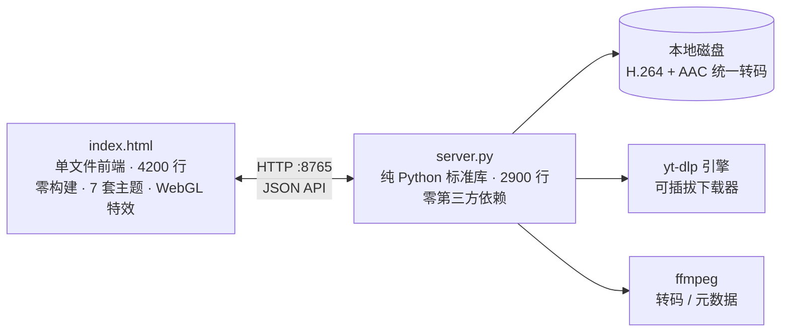

<div align="left">

# Decache

**自托管的本地媒体库与视频播放器。** 把「缓存里的东西」变成「你自己的文件」。

Self-hosted local media library & video player — turn "stuff in your cache" into "files you own".

   

</div>

一个装在你自己设备上的小网站：粘贴链接，视频落进你自己的硬盘；浏览器里播放，带播放列表、字幕、续播。**不上传、不收钱、无广告、无遥测** —— 全部文件留在本地。

后端是**纯 Python 标准库**（2900 行，零第三方依赖），前端是**零构建的单文件** `index.html`（4200 行，双击就能读源码）。装在安卓 Termux 上，手机就是一台私人影音站。

## 真机截图

<table>
<tr>
<td align="center" width="50%"><br><sub>媒体库 · 终端主题 · 标签 / 收藏 / 分辨率角标</sub></td>
<td align="center" width="50%"><br><sub>条目操作 · 封面扫描线</sub></td>
</tr>
</table>

**七套主题 · 一键切换**，含取视频主色实时生成色板的「自适应」：

<table>
<tr>
<td align="center" width="33%"><br><sub>终端 Pipboy</sub></td>
<td align="center" width="33%"><br><sub>复古未来 Synthwave</sub></td>
<td align="center" width="33%"><br><sub>复古 Retro</sub></td>
</tr>
</table>

## 能干什么

| | |
| --- | --- |
| **下载** | 主流视频站，清晰度自选，多链接批量粘贴；统一转 H.264 + AAC，手机 / 平板 / 电视 / 浏览器全认 |
| **播放器** | 进度条实时画面预览、A-B 循环、播放列表、画中画、倍速、字幕、手势（进度 / 音量 / 亮度） |
| **着色器特效** | CRT 电视 / VHS 录像 / 胶片颗粒 / 霓虹辉光，四档 GPU 后处理播放器内一键切 |
| **七套主题** | 单色 / Geist / 奶油玻璃 / 复古未来 / 像素庄园 / 终端 / **自适应**（视频主色实时配色） |
| **媒体库** | 封面墙、彩色标签、收藏、续播（进度存服务器，重装不丢）、批量删除、查重、统计仪表盘 |
| **性能** | 1 万条目规模顺滑翻找；播放器合成层快路径 + 低清画布氛围光，低端机不掉帧 |

## 30 秒装好

**安卓（Termux）**——装 [Termux](https://f-droid.org/packages/com.termux/)（别用 Play 商店版），授权存储，然后一行：

```bash
termux-setup-storage
curl -L -o install.sh https://raw.githubusercontent.com/mike22890/Decache/main/install.sh && bash install.sh
bash ~/decache/start.sh        # 浏览器打开 http://127.0.0.1:8765
```

**Windows / macOS / Linux**——装 Python 3.9+ 和 ffmpeg，从 [Releases](https://github.com/mike22890/Decache/releases/latest) 下 `take-bundle.tar.gz` 解压，Windows 双击 `start.bat`，其余 `bash start.sh`。

**手机看电脑的库**：`config.ini` 里 `bind = 0.0.0.0` 重启，同 WiFi 手机开 `http://电脑IP:8765`。

## 架构



下载引擎与站点解析完全可插拔，源码不内嵌任何站点专属逻辑（CI 里有闸门盯着）。

## 质量纪律

不靠「我测过了」，靠闸门：

- **frontcheck.mjs** —— 前端 7 道静态闸门（语法 / 结构 / 语义逐层扫）
- **selftest.py** —— 端点级自检，隔离临时 HOME 无网络跑全流程
- **chaos_test.py / e2e_real_test.py** —— 混沌注入与真机端到端
- **CI** —— Python 3.9 / 3.11 / 3.13 三版本矩阵 + 安装器同步校验（`install.sh` 由 `sync_install.mjs` 生成，漂移即红）
- 安装脚本自带**自愈**：传输损坏 CRLF 自清、过时镜像自动切回官方源、半残依赖自动补齐

## 常见问题

**下载失败？** 任务页点「补下」，日志页有中文原因。
**文件管理器找不到视频？** Termux 下在 `~/storage/downloads/decache`。
**iOS 播不了？** iOS 只认 MP4(H.264+AAC)，选「自动(最优)」，HEVC/MKV 点「生成通用版」转换。
**特效黑屏？** 渲染管线带黑屏自愈自动回退，也可 FX 切「关」回原生画面。

## 文档

`HANDOVER.md` 架构与 45 节设计教训（改代码前先读） · `CHANGELOG.md` 版本史 · `THEMING.md` 主题开发 · `LEGAL.md` 法律声明 · `SECURITY.md` / `CONTRIBUTING.md`

## License

MIT。仅供个人学习研究使用，请遵守所访问站点条款与当地著作权法；本项目不提供任何站点专属解析器，不协助获取付费或受保护内容。
