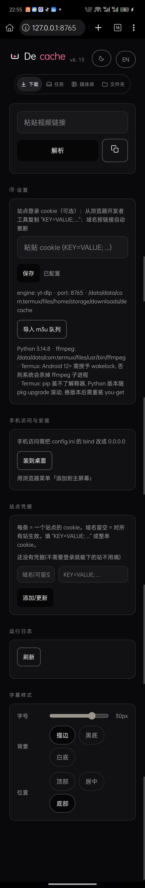
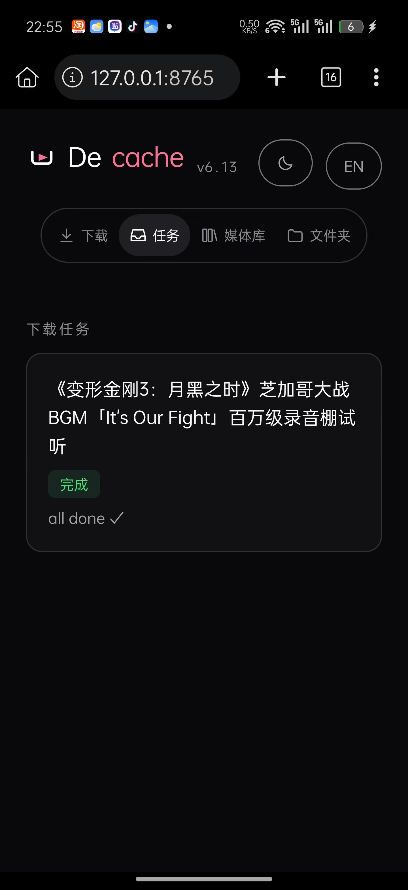
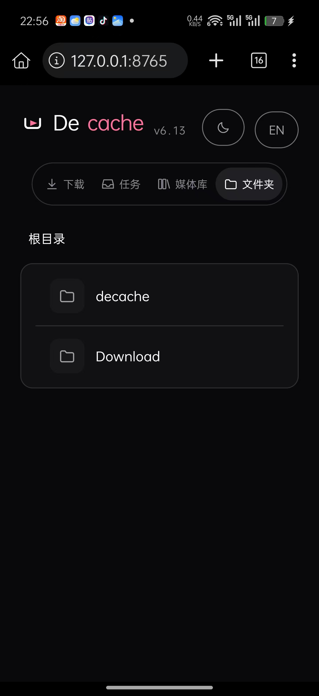

# Decache

<p align="center">
  
</p>

<h1 align="center">Decache</h1>

<p align="center">
  <strong>自托管的本地媒体库与视频播放器</strong><br>
  <strong>Self-hosted local media library and video player</strong><br>
  把"缓存里的东西"变成"你自己的文件"。<br>
  Turn "stuff in your cache" into "files you own".
</p>

<p align="center">
  <a href="LICENSE"></a>
  <a href="https://github.com/mike22890/Decache/actions/workflows/ci.yml"></a>
  
  
  
  
</p>

---

## 这是什么 / What it is

**中文** — Decache 是一个装在你自己设备上的小网站。它做两件事：**下载视频**（粘贴链接，视频就存到你自己的硬盘上）和**播放视频**（在浏览器里播放，带进度条、字幕、播放列表）。所有文件都在你自己的设备上，不上传任何服务器，不收钱，不看广告，不收集数据。界面自带中英切换（右上角 `EN` 按钮）。

**English** — Decache is a small web app that lives on your own device. It does two things: **download videos** (paste a link, the file lands on your own disk) and **play them back** (in the browser, with a seek bar, subtitles and a playlist). Everything stays on your machine — nothing is uploaded, no accounts, no ads, no telemetry. The UI has a built-in Chinese/English toggle (the `EN` button, top right).

## 能干什么 / What it can do

| 功能 / Feature | 说明 / Details |
|---|---|
| 下载视频 / Download | 大多数视频站都能下（含 B站），清晰度自己挑 / Most video sites (including Chinese ones), you pick the quality |
| 本地播放器 / Player | 进度条**实时画面**预览、章节、A-B 循环、播放列表、画中画、倍速、字幕 / Live seek-bar frame preview, chapters, A-B loop, playlist, PiP, speed control, subtitles |
| 媒体库 / Library | 文件夹浏览、彩色标签、收藏、多选删除、查重、磁盘统计 / Folder browsing, colour tags, favourites, multi-select delete, dedupe, disk stats |
| 清晰度可选 / Quality cap | 自动(最优)，或 2160 / 1440 / 1080 / 720 / 480 / 360 / 240 上限 / Auto (best), or cap it from 2160 down to 240 |
| 仅音频 / Audio only | 直接下成 m4a，省空间 / Grab just the audio as m4a to save space |
| 到处都能播 / Plays anywhere | 统一转成 H.264 + AAC，手机 / 平板 / 电视 / 浏览器都认 / H.264 + AAC, which every phone, tablet, TV and browser understands |

## 截图 / Screenshots

真机截图（安卓手机，Termux），未做任何修饰。
Real screenshots from an Android phone (Termux), unmodified.

<table>
<tr>
<td align="center" width="50%"><br><sub>媒体库 · 封面 + 分辨率角标 + 标签 / Library</sub></td>
<td align="center" width="50%"><br><sub>下载页 · 解析 / 清晰度 / 设置 / Download &amp; settings</sub></td>
</tr>
<tr>
<td align="center" width="50%"><br><sub>任务页 · 实时进度 / Tasks</sub></td>
<td align="center" width="50%"><br><sub>文件夹 · 直接浏览目录 / Folders</sub></td>
</tr>
</table>

## 怎么安装 / Installation

### 第 0 步：文件在哪 / Step 0: where the files are

**中文** — 不知道下哪个？**就点这个按钮**：

> **[⬇ 下载最新版安装包 (take-bundle.tar.gz)](https://github.com/mike22890/Decache/releases/latest/download/take-bundle.tar.gz)**

**English** — Not sure what to grab? **Just click this**:

> **[⬇ Download the latest bundle (take-bundle.tar.gz)](https://github.com/mike22890/Decache/releases/latest/download/take-bundle.tar.gz)**

| 你想要什么 / You want | 去哪拿 / Where |
|---|---|
| 完整安装包（解压即用） / Full bundle, unzip and go | [Releases 页面](https://github.com/mike22890/Decache/releases) → `take-bundle.tar.gz` |
| 只要一个安装脚本 / Just the installer script | [install.sh 直接下载](https://raw.githubusercontent.com/mike22890/Decache/main/install.sh) |
| 想看源码 / The source | [Code → Download ZIP](https://github.com/mike22890/Decache/archive/refs/heads/main.zip) |

### 安卓手机（Termux）/ Android (Termux)

**第 1 步 / Step 1** — 装 [Termux](https://f-droid.org/packages/com.termux/)（Play 商店里那个版本太老，别用）。
Install [Termux](https://f-droid.org/packages/com.termux/) (skip the Play Store build — it is outdated).

**第 2 步 / Step 2** — 打开 Termux，把下面这行**整行复制粘贴**进去回车（装依赖，几分钟）。
Open Termux, paste the whole line below and hit enter (installs the dependencies, takes a few minutes).

```bash
pkg install python ffmpeg
```

**第 3 步 / Step 3** — 给存储权限（**只做一次**；不做的话下载的文件在 Termux 私有目录里，手机文件管理器根本看不到）。
Grant storage access (**one time only** — without it the downloads land in a private folder your file manager cannot see).

```bash
termux-setup-storage
```

（弹出权限框 → 点"允许" → 自动跳回 Termux）
(Tap "Allow" in the prompt — Termux jumps back on its own.)

**第 4 步 / Step 4** — 下载并安装（还是整行粘贴，回车）。
Download and install (paste the line, hit enter).

```bash
curl -L -o install.sh https://raw.githubusercontent.com/mike22890/Decache/main/install.sh && bash install.sh
```

> 不会用命令行？去 [Releases 页面](https://github.com/mike22890/Decache/releases) 下载 `take-bundle.tar.gz`，用 ZArchiver 之类的解压工具解开，进到那个文件夹里运行 `bash install.sh`（一样效果）。
> No terminal? Download `take-bundle.tar.gz` from the [Releases page](https://github.com/mike22890/Decache/releases), unzip it, and run `bash install.sh` inside the folder — same result.

**第 5 步 / Step 5** — 启动 / Start it:

```bash
bash ~/decache/start.sh
```

看到 "面板已启动" 就行了。**别关掉这个窗口**（关了服务就停了）。
Wait for "面板已启动" (panel started). **Don't close that window** — closing it stops the server.

**第 6 步 / Step 6** — 手机浏览器打开 → `http://127.0.0.1:8765`
Open it in your phone browser.

### Windows / Mac / Linux

**第 1 步 / Step 1** — 装两个东西 / Install two things:

- Python 3.9+：[python.org/downloads](https://www.python.org/downloads/)
  （Windows 安装时**一定要勾上 "Add Python to PATH"** / on Windows **tick "Add Python to PATH"**）
- ffmpeg：[ffmpeg.org/download.html](https://ffmpeg.org/download.html)
  （Windows 选 "essentials" 那个 zip，解压后把 `bin` 目录加进 PATH / on Windows grab the "essentials" build and add its `bin` folder to PATH）

**第 2 步 / Step 2** — 下载安装包 → [⬇ take-bundle.tar.gz](https://github.com/mike22890/Decache/releases/latest/download/take-bundle.tar.gz)，解压到任意文件夹
Download the bundle, unzip it anywhere.

**第 3 步 / Step 3** — 启动 / Start it:

- **Windows**：双击 `start.bat` / double-click `start.bat`
- **Mac / Linux**：在这个文件夹里打开终端，运行 `bash start.sh` / open a terminal in that folder and run `bash start.sh`

**第 4 步 / Step 4** — 浏览器打开 → `http://127.0.0.1:8765`
Open it in your browser.

### 手机访问电脑上的视频库 / Phone → computer library

把 config.ini 里的 `bind = 127.0.0.1` 改成 `bind = 0.0.0.0`，重启服务。手机和电脑在同一 WiFi 下，手机浏览器打开 `http://电脑的IP:8765`（电脑 IP 在设置页「手机访问与安装」里有显示）。
Edit `bind = 127.0.0.1` to `bind = 0.0.0.0` in `config.ini` and restart. On the same WiFi, open `http://<your-pc-ip>:8765` on the phone (the IP is shown in Settings → 手机访问与安装).

### 装完还是打不开？ / Still not working?

| 现象 / Symptom | 原因和办法 / Why & how |
|---|---|
| 浏览器说"无法访问" / "Can't reach it" | 服务没起来。看终端窗口里的报错；端口被占用就改 `config.ini` 里的 `port` / the server didn't start — read the terminal, and change `port` in `config.ini` if the port is taken |
| 一直转圈 / 视频播不了 / Spinning | ffmpeg 没装好。打开设置页看 "ffmpeg:" 那一行是不是路径 / ffmpeg is missing — the Settings tab shows the path it found |
| 找不到下载的视频 / Can't find the file | 手机上要去 `termux-setup-storage` 授权过；下载目录是 `~/storage/downloads/decache` / you skipped `termux-setup-storage`; files live in `~/storage/downloads/decache` |
| 提示要登录 / Asks for login | 有些站要 cookie，在设置页填一下（格式 `KEY=VALUE; ...`）/ some sites need a cookie — paste it in Settings (`KEY=VALUE; ...`) |

## 怎么用 / How to use

### 下载一个视频 / Download a video

1. 打开 **下载** 页 / open the **下载 (Download)** tab
2. 粘贴视频链接，点"解析" / paste the link, hit 解析 (Parse)
3. 勾选想下的分P，选清晰度，点"下载所选" / tick the parts you want, pick a quality, hit 下载所选
4. 去 **任务** 页看进度 / watch it on the **任务 (Tasks)** tab

### 看下载好的视频 / Play what you downloaded

1. 打开 **媒体库** 页 / open the **媒体库 (Library)** tab
2. 点视频封面 → 播放器打开 / tap a cover to open the player
3. 点画面 → 控制条出现（6 秒后自动消失）/ tap the picture — the controls appear (they auto-hide after 6 seconds)

### 其他功能 / Everything else

- **标签 / Tags** — 卡片上点"标签" chip，选颜色 / tap the 标签 chip on a card and pick a colour
- **多选删除 / Bulk delete** — 工具栏"多选" → 勾选 → 底部"删除" / tap 多选, tick, then 删除
- **播放列表 / Playlist** — 播放器顶栏 ≡ 按钮 / the ≡ button in the player header
- **章节 / Chapters** — 播放器顶栏 "章节" 按钮 / the 章节 button in the player header
- **字幕 / Subtitles** — 播放器顶栏 CC 按钮，自动找同目录的 srt/vtt / the CC button; it looks for .srt/.vtt next to the video
- **画质切换 / Other formats** — 播放器里点 "生成通用版"，把 HEVC/AV1/MKV 转成全平台通吃的 MP4 / converts them into an MP4 every device understands

## 常见问题 / FAQ

**Q: 下载失败怎么办？/ Download failed?**
打开 **任务** 页，失败的 P 旁边有"补下"按钮。或者去 **日志** 页看具体原因（中文翻译）。
Open the **任务 (Tasks)** tab and hit 补下 (re-download) next to the failed part. The **日志 (Log)** tab has the reason, in plain language.

**Q: 视频在手机相册/文件管理器里找不到？/ Can't find the file on my phone?**
下载目录默认是 `~/storage/downloads/decache`（Termux）或 `~/Downloads/decache`（电脑）。用手机文件管理器去那里找。或者在 **磁盘** 页看占了多少空间、在哪里。
It lands in `~/storage/downloads/decache` (Termux) or `~/Downloads/decache` (desktop). The **磁盘 (Disk)** tab shows where and how much space it uses.

**Q: iOS Safari 播不了？/ Won't it play on iOS?**
iOS 只支持 MP4 + H.264 + AAC。下载时选"自动(最优)"会自动选这个组合；如果是 HEVC/MKV，点播放器里的"生成通用版"转换一下。
iOS only plays MP4 + H.264 + AAC. Picking 自动(最优) gives you that; for HEVC/MKV, hit 生成通用版 in the player once.

**Q: 重新下载 / 删掉视频？/ Re-download or delete?**
- 重新下：媒体库卡片的 ↻ 按钮 / the ↻ button on a library card
- 删掉整个视频：🗑 按钮（会删磁盘上的文件，不可恢复）/ the 🗑 button (removes the files from disk — no undo)
- 删一个分P：展开分P列表里的 🗑 / the 🗑 inside an expanded part list

## 合法声明 / Legal

**中文** — 仅供个人学习研究与个人使用。请自行确保遵守所访问站点的服务条款与所在司法辖区的著作权法律。本项目不提供任何站点专属解析器，也不协助获取付费或受保护内容。

**English** — For personal study, research and personal use only. You are responsible for complying with the terms of service of the sites you access and with the copyright law of your jurisdiction. This project ships **no** site-specific parser and does not assist with obtaining paid or protected content.

## License

MIT — see [LICENSE](LICENSE).

## 文档 / Documentation

- `HANDOVER.md` — 架构、设计决策、兼容性矩阵、已知限制，以及那些血淋淋的教训（改代码前先读） / architecture, design decisions, compatibility matrix, known limitations, and the blood-stained lessons (read before editing)
- `LEGAL.md` — 法律声明、边界范围、侵权投诉流程 / legal notice, scope boundaries, infringement report process
- `THIRD_PARTY_LICENSES.md` — 外部依赖归属 / attribution for external dependencies
